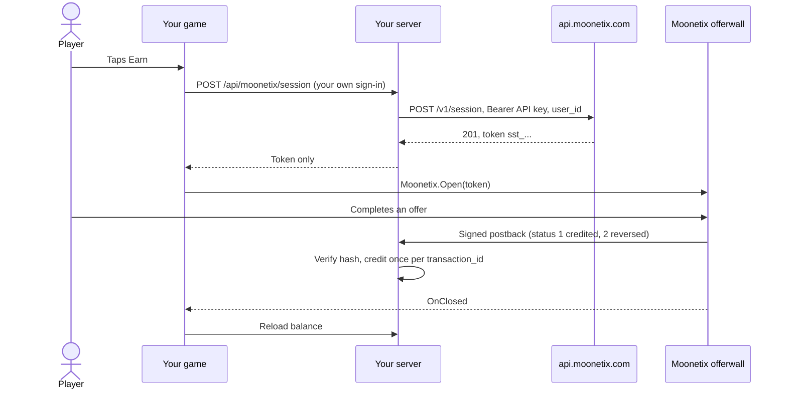

# Moonetix Offerwall for Unity

**Open the Moonetix offerwall from your Android and iOS game with `Moonetix.Open(token)`, using a single-use token your server creates.**

[](https://github.com/moonetix/moonetix-unity/actions/workflows/ci.yml)
[](https://moonetix.com)
[](LICENSE.md)
[](https://docs.moonetix.com/unity-sdk#install)
[](https://docs.moonetix.com/unity-sdk)
[](https://moonetix.com/register?from=github-moonetix-unity)
[](https://moonetix.com/integrations/unity)

This is the source of the `com.moonetix.offerwall` package for [Moonetix](https://moonetix.com). Inside, it calls the native Moonetix Android and iOS SDKs, so the offerwall screen, your top bar branding and store links behave exactly as in a native app. Moonetix is an affiliate network: players earn your in-game currency by completing offers, and you earn per completed offer.

The contents match the released 2.0.1 package. Games should install it from the Moonetix registry.

> **Get your App ID and API key: sign up free at https://moonetix.com/register?from=github-moonetix-unity**

## Built for game builds

1. **No manual native setup.** When Unity generates the Gradle project, the package adds the Moonetix Maven repository (for `com.moonetix` only), the Android SDK and its R8 rule, also for exported projects and custom Gradle templates. On iOS it links and embeds the SDK in the Xcode project and stops the build with a clear message if the deployment target is below 13.0.
2. **Events on the main thread.** `OnOpened`, `OnClosed` and `OnError` are raised on the Unity main thread, so you can update UI directly.
3. **Testable in the Editor.** In the Editor, `Open` still checks the App ID and token, then reports `Unsupported`. You can walk through the whole flow before you build for a device.

## Request flow



## Quick start

### 1. Install

Unity 2022.3 LTS or Unity 6 (6000.0) or newer. The plugin is in the Moonetix package registry. Add the registry and the package to `Packages/manifest.json`:

```json
{
  "scopedRegistries": [
    {
      "name": "Moonetix",
      "url": "https://moonetix.com/upm",
      "scopes": ["com.moonetix"]
    }
  ],
  "dependencies": {
    "com.moonetix.offerwall": "2.0.1"
  }
}
```

You can also add the registry in Project Settings, Package Manager, and then install Moonetix Offerwall from My Registries in the Package Manager window. Prefer a file? Download [moonetix-unity-offerwall-2.0.1.tgz](https://moonetix.com/downloads/moonetix-unity-offerwall-2.0.1.tgz) and choose Install package from tarball in the Package Manager.

| Platform | Status |
| --- | --- |
| Android | Supported on every Android version your Unity version supports. |
| iOS 13 or newer | Supported. Build with Xcode 16 or newer, and set Target minimum iOS Version to 13.0 or higher. |
| Unity Editor, desktop, WebGL | `Open` checks the app ID and the token, then reports `Unsupported`. |

### 2. Add a token endpoint to your game server

Anyone can unpack a game build, so the API key never goes into it. Your server checks which player is signed in, calls `POST https://api.moonetix.com/v1/session` with that player's ID, and returns only the token. The [docs](https://docs.moonetix.com/android-sdk#token-endpoint) have the endpoint in Node.js, PHP and Python, and [moonetix-ios-sdk/token-endpoint](https://github.com/moonetix/moonetix-ios-sdk/tree/main/token-endpoint) is a tested Node.js version that works for every Moonetix SDK.

Keep the API key, from the API page of your dashboard, in the server environment (see [`.env.example`](.env.example)). When Moonetix answers 403 (`app_not_live` or `user_blocked`), do not show the offerwall.

### 3. Open the offerwall

Call `Init` once with the App ID from the Integration section. Then open the offerwall with a fresh token from your server.

```csharp
using MoonetixOfferwall;
using UnityEngine;

public class EarnButton : MonoBehaviour
{
    void Awake()
    {
        Moonetix.Init("YOUR_APP_ID");
    }

    // Call this with a fresh token from your server.
    public void ShowOfferwall(string token)
    {
        Moonetix.Open(token);
    }
}
```

`Open` never throws for offerwall problems. They arrive as events. To set the top bar yourself, pass `new MoonetixOptions(title: "Earn coins", toolbarColor: new Color(0f, 0.29f, 0.73f), showLogo: false)`; anything left `null` comes from the Design section of your offerwall. `Moonetix.IsSupported` is `false` in the Editor and on platforms other than Android and iOS, so you can hide the Earn button there. The [docs](https://docs.moonetix.com/unity-sdk#full-example) have a complete Earn button that fetches the token with `UnityWebRequest`. The package also ships an Offerwall demo sample: Window, Package Manager, Moonetix Offerwall, Samples.

## Events

```csharp
void OnEnable()
{
    Moonetix.OnClosed += RefreshBalance;
    Moonetix.OnError += HandleError;
}

void OnDisable()
{
    Moonetix.OnClosed -= RefreshBalance;
    Moonetix.OnError -= HandleError;
}

void HandleError(MoonetixError error)
{
    Debug.LogWarning(error.CodeName + ": " + error.Message);
}
```

| Event | When |
| --- | --- |
| `OnOpened` | The offerwall finished loading. On Android the game is paused while the offerwall is open, so this can arrive when the player returns. |
| `OnClosed` | The player closed the offerwall. Reload the player's balance from your server here. |
| `OnError` | `NotInitialized`, `InvalidAppId`, `InvalidToken`, `TokenExpiredOrUsed`, `Network`, `Unsupported` or `Unknown`. `CodeName` gives the native name, for example `TOKEN_EXPIRED_OR_USED`. |

Events drive your UI, not the player's balance. Credit rewards from the signed postback on your server, never from an event.

## Troubleshooting

| What you see | Cause and fix |
| --- | --- |
| `Unsupported` in Play mode | Expected: the offerwall opens only in Android and iOS players. The message confirms that the App ID and token have the right format. |
| `InvalidAppId` | The value in `Init` is not the 24-character lowercase hex App ID. Passing the API key here is the usual mistake. |
| `InvalidToken` right after `Open` | You passed the whole JSON answer or an empty string. Pass only the `token` field, which starts with `sst_`. |
| `TokenExpiredOrUsed` | The token is older than 10 minutes or was opened twice. Request a new token on every tap. |
| iOS build stops with a deployment target message | Set Target minimum iOS Version to 13.0 or higher in Player Settings. |
| A "VPN detected" page instead of offers | The device is on a VPN, a proxy or a cloud network. Test on a normal home or mobile connection. |

## Inside the package

1. `Moonetix.Init` and `Moonetix.Open` validate the App ID and token in C# and pick the platform bridge: `AndroidNative` (JNI to `MoonetixUnityBridge.java`) or `IosNative` (`MoonetixUnityBridge.m`).
2. On Android, `MoonetixAndroidGradleStep` patches the generated Gradle project through `MoonetixGradlePatcher`. Every change is idempotent.
3. On iOS, `MoonetixIosBuild` checks the deployment target, copies `MoonetixOfferwall.xcframework` from `Native~/iOS` into the Xcode project, links it to UnityFramework and embeds it in the app.
4. Both native SDKs keep only `wall.moonetix.com` pages inside the offerwall screen. Offer links open in the store or the browser.
5. Native events are queued and raised on the main thread by `MoonetixMainThread`.
6. Rewards never pass through the game. Moonetix calls your postback URL, and your server credits the player.

| Path | Purpose |
| --- | --- |
| `Runtime/` | Public API (`Moonetix`, `MoonetixOptions`, `MoonetixError`), platform bridges, Android and iOS plugin sources |
| `Editor/` | Gradle and Xcode build steps |
| `Tests/Editor/` | Edit mode tests: validation, errors, options, API, build steps |
| `Samples~/OfferwallDemo/` | Demo scene with an Earn button and an event log |
| `Native~/iOS/` | Location of the iOS SDK binary, filled by `Tools~/fetch-ios-sdk.sh` |

## Security checklist

- Create sessions on your server only. Never put the API key or the link hash salt in your game: anyone can unpack a build.
- Take the player ID from your own sign-in, never from the request. Otherwise anyone could open the offerwall as another player.
- Return only the token to the game, and create a new one each time the player taps Earn.
- Credit rewards only from the signed server-to-server postback: verify the hash with a constant-time comparison first, credit each `transaction_id` once, and let status 2 take back only what was credited. See [offerwall-postback-handlers](https://github.com/moonetix/offerwall-postback-handlers).
- Reward players only for completed offers. Never reward joins, invites, likes, reviews or other engagement. Players must be 16 or older.

**Store privacy.** Declare User ID, Device ID, Coarse Location and Product Interaction for App Functionality, linked to the user and not used for tracking, in App Store Connect and in the Google Play Data safety form. See [App Store privacy details](https://docs.moonetix.com/ios-sdk#privacy).

## Testing

### From this source

The iOS SDK binary is not in this repository. Before you add this folder to a project as a local package, or run the edit mode tests, fetch it from the repository root:

```bash
sh "Tools~/fetch-ios-sdk.sh"
```

The script downloads `MoonetixOfferwall-2.0.1.xcframework.zip` from moonetix.com, checks its SHA-256 and unpacks it to `Native~/iOS/`. Then add the package from disk in the Package Manager, add `com.moonetix.offerwall` to `testables` in your project's `Packages/manifest.json`, and run the edit mode tests in the Test Runner.

Without Unity, .NET 8 runs the validation, error and build step tests, and Node checks `package.json` and the `.meta` files:

```bash
sh "Tools~/fetch-ios-sdk.sh"     # once; PackageShipsTheIosFramework needs the binary
dotnet test "Tests~/DotNet"      # 41 tests
node "Tools~/check-package.mjs"
```

CI skips the binary download and runs `dotnet test "Tests~/DotNet" --filter "Name!=PackageShipsTheIosFramework"` (40 tests).

`ApiTests` and `OptionsTests` use UnityEngine and run only in the Test Runner.

### With Moonetix

1. Create a session for a test user from your server and open it in a development build on an Android phone, an iPhone or the iOS Simulator.
2. Check that the offerwall opens, that an offer opens in the store or the browser, and that back and close work.
3. In the dashboard, open Offerwalls, your offerwall, Integration, and click **Send a test postback**. You can also send one from the Postback page. Send status 1, then status 2 for the same player, and check that the balance goes up and back down.
4. Test on a normal home or mobile connection. On a VPN, a proxy or a cloud device the offerwall shows a block page instead of offers.

Clicks through the plugin show as `sdk` in the `{integration}` postback macro. For error codes and fixes, see [Troubleshooting](https://docs.moonetix.com/unity-sdk#troubleshooting) and [Testing](https://docs.moonetix.com/testing).

## Further reading

- Docs: [Unity SDK](https://docs.moonetix.com/unity-sdk), [Postbacks](https://docs.moonetix.com/postbacks), [Credits and reversals](https://docs.moonetix.com/credits-and-reversals), [Testing](https://docs.moonetix.com/testing)
- Academy: [How to Add an Offerwall to a Unity Game](https://moonetix.com/academy/integrations/unity-offerwall)
- Academy: [Best Offerwall SDK for Unity Games: SDK or Web Wall?](https://moonetix.com/academy/monetization/best-offerwall-sdk-unity)
- Moonetix for Unity: [moonetix.com/integrations/unity](https://moonetix.com/integrations/unity)
- Moonetix for games: [moonetix.com/industries/games](https://moonetix.com/industries/games)
- A complete project: [offerwall-unity-example](https://github.com/moonetix/offerwall-unity-example)

## Sign up

**https://moonetix.com/register?from=github-moonetix-unity** is free. Every publisher application is reviewed by hand. After approval, add the game, name your currency and set its rate, pass the App ID to `Moonetix.Init`, and keep the API key on your server.

## More Moonetix examples

All on [github.com/moonetix](https://github.com/moonetix).

**SDKs**

- [moonetix-android-sdk](https://github.com/moonetix/moonetix-android-sdk): Android SDK source (Kotlin and Java)
- [moonetix-ios-sdk](https://github.com/moonetix/moonetix-ios-sdk): iOS SDK install guide, SwiftUI sample and token endpoint
- [moonetix-flutter](https://github.com/moonetix/moonetix-flutter): Flutter plugin source
- [moonetix-react-native](https://github.com/moonetix/moonetix-react-native): React Native and Expo package source

**Server side**

- [offerwall-postback-handlers](https://github.com/moonetix/offerwall-postback-handlers): postback handlers for common languages
- [offerwall-express](https://github.com/moonetix/offerwall-express), [offerwall-laravel](https://github.com/moonetix/offerwall-laravel), [offerwall-django](https://github.com/moonetix/offerwall-django)
- [offerwall-firebase-functions](https://github.com/moonetix/offerwall-firebase-functions), [offerwall-supabase](https://github.com/moonetix/offerwall-supabase)

**Web and apps**

- [offerwall-nextjs-starter](https://github.com/moonetix/offerwall-nextjs-starter), [offerwall-react-vite](https://github.com/moonetix/offerwall-react-vite), [offerwall-vue-nuxt](https://github.com/moonetix/offerwall-vue-nuxt)
- [rewards-site-starter](https://github.com/moonetix/rewards-site-starter), [moonetix-offerwall-wordpress](https://github.com/moonetix/moonetix-offerwall-wordpress)
- [offerwall-flutter-example](https://github.com/moonetix/offerwall-flutter-example), [offerwall-react-native-example](https://github.com/moonetix/offerwall-react-native-example)
- [offerwall-chrome-extension](https://github.com/moonetix/offerwall-chrome-extension), [offerwall-electron](https://github.com/moonetix/offerwall-electron)

**Games and communities**

- [offerwall-unity-example](https://github.com/moonetix/offerwall-unity-example), [offerwall-godot](https://github.com/moonetix/offerwall-godot), [offerwall-html5-game](https://github.com/moonetix/offerwall-html5-game)
- [telegram-mini-app-offerwall](https://github.com/moonetix/telegram-mini-app-offerwall), [discord-rewards-bot](https://github.com/moonetix/discord-rewards-bot)
- [awesome-offerwalls](https://github.com/moonetix/awesome-offerwalls): a curated list of offerwall resources

## License

Apache License 2.0. See [LICENSE.md](LICENSE.md).
